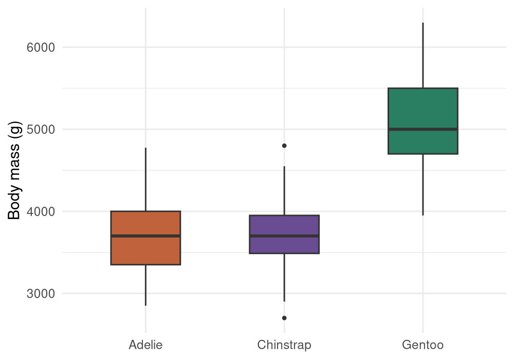
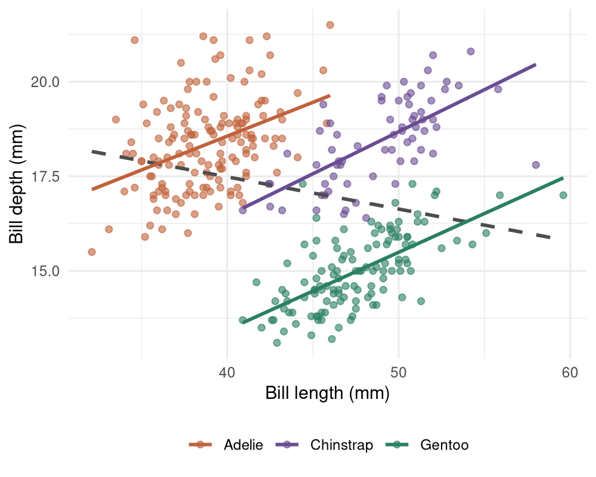

```{r}
#| include: false
nums <- jsonlite::fromJSON("../results/numbers.json")
```

# Introduction

Three penguin species of the genus *Pygoscelis* breed on the islands near Palmer Station,
on the Antarctic Peninsula. @gorman2014 measured adults of all three over three seasons.
The data are openly available [@horst2020] and are used here to show a document whose
numbers come straight from the analysis.

# Methods

The analysis uses the `r nums$n_total` penguins in the dataset
(`r nums$n_species$Adelie` Adélie, `r nums$n_species$Chinstrap` Chinstrap and
`r nums$n_species$Gentoo` Gentoo). Bill depth was regressed on bill length, once for the
pooled sample and once within each species.

# Results

Gentoo penguins were the heaviest, at `r nums$mass_by_species$Gentoo` g on average,
against `r nums$mass_by_species$Adelie` g for Adélie and
`r nums$mass_by_species$Chinstrap` g for Chinstrap (@fig-mass).

Pooling the three species, longer bills appear shallower: the slope is
`r nums$slope_pooled` mm per mm. Within every species the relationship is the opposite,
with slopes between `r min(unlist(nums$slope_by_species))` and
`r max(unlist(nums$slope_by_species))` (@fig-bill). The pooled trend is produced by the
differences between species, a case of Simpson's paradox.

{#fig-mass width=80%}

{#fig-bill width=80%}

# Discussion

Every number in this text is read from `results/numbers.json`, which the analysis writes.
If the data change, the analysis runs again and the paper, the report and the slides update
together.
